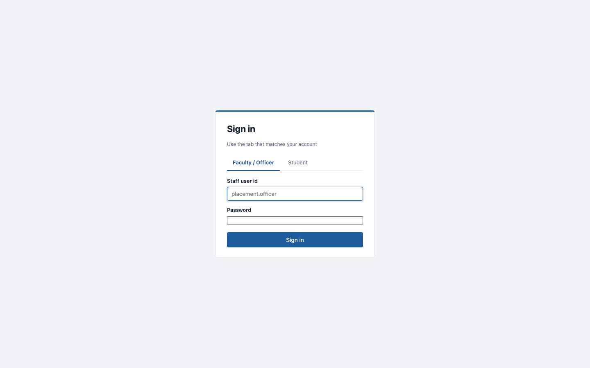
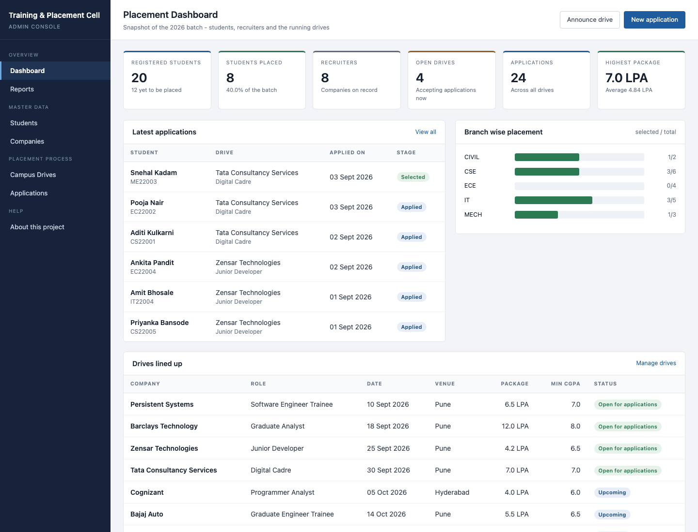
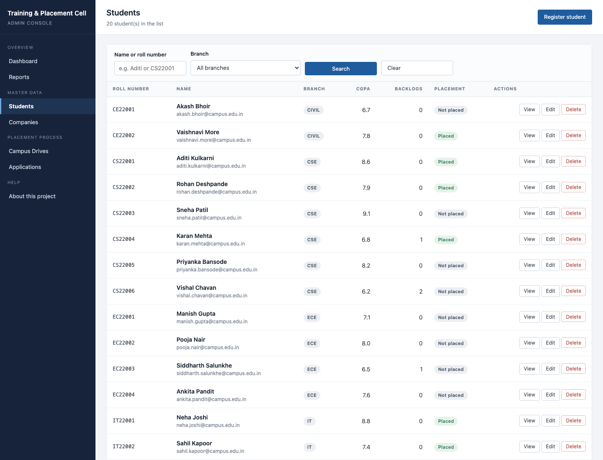
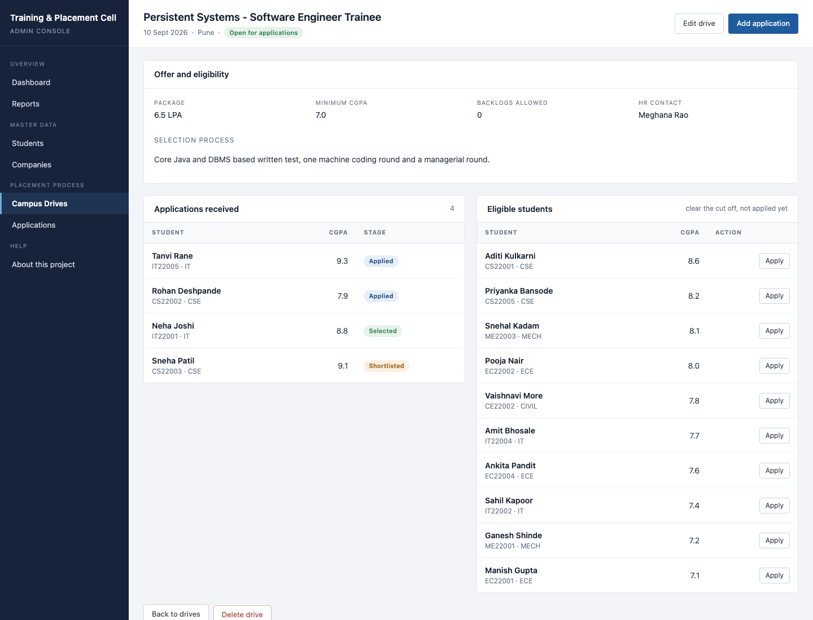
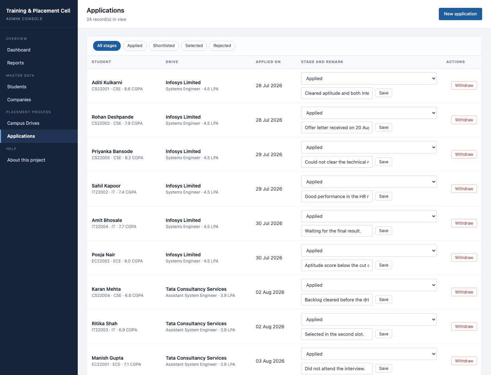
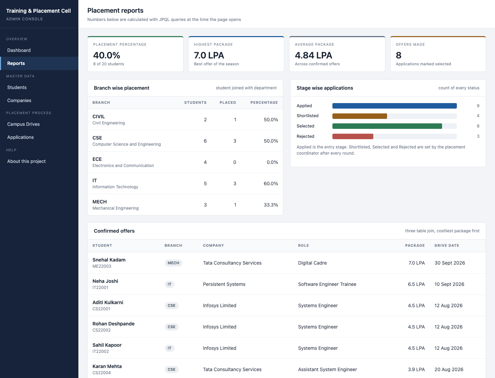

# Placement Portal — Student Placement Management System

> A Spring Boot 3 web portal that replaces a college placement cell's registers: students, recruiters, campus drives, applications with eligibility rules, and placement reports — with role-based sign-in and BCrypt-hashed passwords.

Advanced Java mini-project (**team project**, B.Tech Computer Engineering). Runs out of the box on an in-memory H2 database with one season of sample data.

## Screenshots

| Sign in | Dashboard | Students |
| --- | --- | --- |
|  |  |  |
| **Drive details** | **Applications** | **Reports** |
|  |  |  |

> _TODO: re-capture screenshots if the UI changes; add a live demo link once deployed._

## Features

| Module | What it does |
| --- | --- |
| **Students** | List with search + branch filter, profile with application history, add / edit / delete (Bean Validation on every field) |
| **Companies** | Recruiter master with search; profile lists all drives of that company |
| **Drives** | Announce a drive with eligibility (min CGPA, max backlogs); Upcoming / Open / Closed status; eligible-student list |
| **Applications** | Apply a student to an open drive, move through stages, withdraw, filter by stage. Rules: no duplicate application, eligibility enforced server-side |
| **Reports** | Placement %, highest and average package, department-wise and stage-wise stats, offer list |
| **Sign in** | Two tabs: staff (officer, coordinators, HODs — full rights) and students (own profile, recruiter list, drives, self-apply). Server-side `HandlerInterceptor` guards every URL |

Security notes: passwords are stored as **BCrypt hashes** (`spring-security-crypto`); the session only holds a small `LoggedInUser` DTO, never the password; wrong user id and wrong password return the same message; students can only apply as themselves (id comes from the session, not the form).

## Architecture

```mermaid
flowchart LR
    B[Browser] -->|HTTP form posts| I[AuthInterceptor<br/>session + role check]
    I --> C[Controllers<br/>Spring MVC + @Valid]
    C --> S[Services<br/>@Transactional business rules<br/>eligibility, duplicates, reports]
    S --> R[Spring Data JPA repositories]
    R --> DB[(H2 in-memory<br/>or MySQL)]
    C --> V[Thymeleaf templates<br/>server-rendered pages]
    S --> E[PasswordEncoder<br/>BCrypt]
    C -.exceptions.-> G[GlobalExceptionHandler]
```

Layering rule: a controller never calls a repository directly. Data model: `department`, `student`, `company`, `drive`, `application`, `staff` (6 tables).

## Tech stack

Java 17 · Spring Boot 3.3 · Spring MVC · Spring Data JPA (Hibernate) · Bean Validation · Thymeleaf · H2 / MySQL · spring-security-crypto (BCrypt) · JUnit 5 · Maven (wrapper included) · Docker

## Quick start

Prerequisite: JDK 17+ (nothing else — the Maven wrapper downloads Maven, H2 needs no install).

```bash
git clone https://github.com/priyankabana/placement-portal.git
cd placement-portal
./mvnw spring-boot:run          # http://localhost:8080  (H2, sample data)
# or
./run.sh                        # build + run on H2;  ./run.sh 8099 for another port
```

Demo accounts (sample data only — full list in [`docs/login-credentials.txt`](docs/login-credentials.txt)):

| Sign in as | Tab | User id | Password |
| --- | --- | --- | --- |
| Placement Officer | Faculty / Officer | `placement.officer` | `officer@123` |
| CSE HOD | Faculty / Officer | `cse.hod` | `cse@hod123` |
| Student | Student | `CS22001` | `cs22001@2026` |

Student password rule: roll number in lower case + `@` + passing-out year.

### MySQL profile (persistent storage)

```bash
mysql -u root -e "CREATE DATABASE IF NOT EXISTS placement_db;
  CREATE USER IF NOT EXISTS 'placement'@'localhost' IDENTIFIED BY '<your-password>';
  GRANT ALL PRIVILEGES ON placement_db.* TO 'placement'@'localhost';"
cp .env.example .env            # set DB_PASSWORD (and DB_URL / DB_USERNAME if different)
./run-mysql.sh
```

Hibernate creates the tables and `data-mysql.sql` seeds them with `INSERT IGNORE`, so restarts don't duplicate rows. If you have a MySQL database from the pre-BCrypt version, drop and recreate `placement_db` (the password column grew from 40 to 100 chars and the seed passwords are now hashes).

## Environment variables

| Variable | Profile | Default | Purpose |
| --- | --- | --- | --- |
| `DB_URL` | mysql | `jdbc:mysql://localhost:3306/placement_db?...` | JDBC URL |
| `DB_USERNAME` | mysql | `placement` | DB user |
| `DB_PASSWORD` | mysql | — (required) | DB password |
| `H2_CONSOLE_ENABLED` | h2 | `true` | Set `false` on any public deployment |
| `PORT` | Docker | `8080` | HTTP port (used by the Dockerfile entrypoint) |
| `SPRING_PROFILES_ACTIVE` | any | `h2` | `h2` or `mysql` |

## Project structure

```
src/main/java/com/college/placement/
  config/        AuthInterceptor, WebConfig, PasswordConfig (BCrypt), form converters
  controller/    Dashboard, Student, Company, Drive, Application, Report, Auth, StudentPortal
  service/       business rules (eligibility, duplicates, reports, auth)
  repository/    Spring Data JPA interfaces (derived + JPQL queries)
  model/         JPA entities + enums (DriveStatus, ApplicationStatus, UserRole)
  dto/           form objects, dashboard/report DTOs, LoggedInUser
  exception/     custom exceptions + GlobalExceptionHandler
src/main/resources/
  templates/     Thymeleaf pages (layout fragment, CRUD screens, reports, login, error)
  static/        hand-written CSS + small JS
  application*.properties, data.sql (H2), data-mysql.sql (MySQL)
src/test/java/   JUnit 5 + @SpringBootTest
docs/            screenshots, presentation, demo credentials
DOCUMENTATION.md full write-up: architecture, DB design & normalisation, roles, test list
```

## Testing

```bash
./mvnw test        # 7 tests, all passing
```

| Test class | Covers |
| --- | --- |
| `StudentCrudTest` | create → read → update → delete, 404 after delete, duplicate roll number refused |
| `ApplicationRuleTest` | duplicate application rejected, low-CGPA application rejected, placed count matches SELECTED applications |
| `AuthServiceTest` | seeded accounts sign in only with the right password; new students get a BCrypt-hashed default password |

## Deployment notes

- **Render / Railway (Docker):** the included `Dockerfile` builds with the Maven wrapper and runs as a non-root user on `$PORT`. With the default **H2 profile it needs no external database** — a self-contained demo whose data resets on every restart. Set `H2_CONSOLE_ENABLED=false` for public deployments.
- **Persistent:** set `SPRING_PROFILES_ACTIVE=mysql` plus `DB_URL`, `DB_USERNAME`, `DB_PASSWORD` for a managed MySQL (Railway MySQL, Aiven, PlanetScale-compatible).
- Not suitable for Vercel (server-rendered Java app).
- Before a real deployment: rotate/remove the demo accounts, consider the full Spring Security filter chain (CSRF tokens, login throttling), and turn off `spring.jpa.show-sql`.

## Team project & my contributions

Built by a team of four as a college mini-project (module ownership is described in `DOCUMENTATION.md` §5.2).

**My contributions** _(TODO — Priyanka to fill in)_:

- [ ] TODO: modules / layers I owned (e.g. entities & repositories, services, controllers, Thymeleaf UI)
- [ ] TODO: business rules or reports I implemented
- [ ] TODO: tests / documentation / presentation work
- [x] Post-submission hardening: BCrypt password hashing, env-based DB credentials, Maven wrapper, Dockerfile

## What I learned

- Layered Spring Boot design (controller → service → repository) and why business rules belong in `@Transactional` services.
- JPA entity modelling, relationships with cascade/orphan removal, derived queries vs JPQL, and the `open-in-view` trade-off.
- Server-side validation with Bean Validation and a global exception handler that maps domain errors to friendly pages.
- Session-based authentication with an interceptor, role checks, and storing passwords as BCrypt hashes instead of plain text.
- Profile-based configuration (H2 for zero-setup demos, MySQL for persistence) and writing idempotent seed data.
- Integration testing with `@SpringBootTest` + `@Transactional` rollbacks.

## License

MIT © 2026 Priyanka Bana — see [LICENSE](LICENSE).
